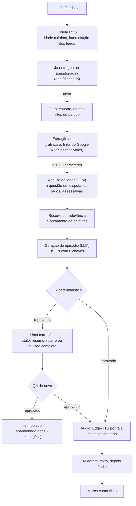

# TechDigest

Pipeline em lote que coleta notícias de feeds RSS, escreve com um modelo de linguagem um resumo didático e o roteiro de
um podcast a várias vozes para cada notícia, sintetiza o áudio e entrega texto e áudio num chat do Telegram. Roda sem
ninguém olhando: uma execução por dia, à mão ou por um timer do systemd.

Dois boletins dividem cada execução: o **TechDigest** (tecnologia) e o **PulsoBR** (política brasileira). Os feeds são
em português, do Brasil, de Portugal e de Macau. O código, os comentários, os logs e os prompts estão em português do
Brasil.

- O modelo roda localmente, no Ollama (padrão `gemma4:26b`), ou em qualquer endpoint compatível com a API da OpenAI.
- A voz é do Edge-TTS, montada com o ffmpeg.
- Antes de qualquer entrega, um QA determinístico confere o episódio contra os textos das fontes: números, atribuições,
  lados de uma disputa e tamanho. O episódio que não passa recebe uma correção e, se ainda falhar, não é entregue.

Licença: [GPL-3.0-or-later](LICENSE).

## Sumário

- [O que cada notícia entrega](#o-que-cada-notícia-entrega)
- [Como funciona](#como-funciona)
- [Regras editoriais e QA](#regras-editoriais-e-qa)
- [Requisitos](#requisitos)
- [Instalação](#instalação)
- [Configuração](#configuração)
- [Uso](#uso)
- [Scripts de diagnóstico](#scripts-de-diagnóstico)
- [Desenvolvimento](#desenvolvimento)
- [Estrutura do repositório](#estrutura-do-repositório)
- [Documentação](#documentação)
- [Estado do projeto](#estado-do-projeto)
- [Licença](#licença)

## O que cada notícia entrega

No começo do lote, uma mensagem de cabeçalho (`📰 TechDigest — dd/mm/aaaa hh:mm`). Depois, para cada notícia, duas
mensagens no chat:

1. **O texto**, em HTML do Telegram:

   ```
   📰 <título curto, sem sensacionalismo e sem percentuais>

   <resumo didático de 7 a 10 frases>

   🔑 Pontos-chave:
     • <2 a 5 pontos que se entendem sozinhos>

   💡 Por que importa: <1 a 3 frases com o impacto que os textos trazem>

   🔗 <nome do veículo>          (o link da matéria original)
   ```

2. **O áudio**, um mp3 de uns 3 a 5 minutos: um episódio conduzido pela apresentadora **Helena**, que abre, faz as
   perguntas e fecha sem tomar posição, e por um analista para cada lado da pauta. Quando a notícia não tem disputa, há
   um analista só, que explica a posição sem defendê-la. Cada personagem tem a sua voz neural do Edge-TTS (Helena com a
   `pt-BR-FranciscaNeural`; os analistas com a `pt-BR-AntonioNeural`, a `pt-BR-ThalitaNeural` e a
   `pt-BR-GustavoNeural`).

A notícia entregue é marcada como vista e não volta. A que não foi entregue volta na execução seguinte.

## Como funciona



Em detalhe:

1. **Coleta** (`collectors/rss.py`): baixa cada feed de `config/feeds.txt` e descarta as notícias com mais de 7 dias.
   Depois intercala os feeds, para que o limite de notícias por execução (`MAX_NEWS`, 20) não fique todo com os
   primeiros da lista; é o "boletim duplo". Um feed que falha por erro de rede é tentado de novo em rodadas, com espera
   crescente. Se algum feed fica de fora, chega um aviso curto no Telegram; se ficam todos, a execução para.
2. **Deduplicação e filtro** (`storage/dedup.py`, `processing/filtro.py`): o SQLite guarda o SHA-256 das URLs
   entregues e a contagem de reprovações de cada item. O filtro tira esporte, ofertas e sites de partido pelo caminho
   da URL, pela categoria do feed e por uma lista de domínios (`config/sites_de_partido.txt`), nunca pelo título.
3. **Extração** (`processing/extractor.py`): o texto vem da página do veículo, pelo trafilatura. Um link do Google
   Notícias é resolvido antes para a URL do veículo, e o filtro roda de novo sobre ela. Um texto com menos de 1200
   caracteres é descartado, para que uma manchete sozinha nunca vire episódio.
4. **Geração** (`ai/summarizer.py`):
   1. Uma chamada ao modelo encontra a questão em disputa e os lados: cada lado é uma resposta sustentada por atores
      com nome. Uma posição só de grupos sem nome vira uma ressalva.
   2. Os textos são recortados por relevância, para caber na janela do modelo sem truncar nada.
   3. Uma segunda chamada escreve o episódio: título, resumo, pontos-chave, por que importa, personagens, roteiro, se
      houve divergência e as fontes citadas.
   4. O QA confere o resultado. Com problema, o episódio recebe uma correção só, do tipo que os problemas pedem.
5. **Áudio** (`audio/tts.py`): cada fala é sintetizada à parte, até três ao mesmo tempo. O silêncio que o Edge-TTS põe
   nas pontas e entre as frases é aparado, e o ffmpeg junta tudo num mp3 sem tag ID3.
6. **Entrega** (`delivery/telegram.py`): o texto e depois o áudio. Só depois de entregar, a notícia é marcada como
   vista.
7. **Registro** (`registro.py`): cada execução grava em `data/execucoes/<data-hora>/` os textos usados, a análise de
   lados, o orçamento, os problemas do QA, as correções e cada episódio, aprovado ou não. A gravação é atômica, e o
   registro fica guardado por 30 dias.

Uma notícia custa pelo menos duas chamadas ao modelo (análise de lados e geração) e no máximo oito, com as correções e
as novas tentativas de JSON incompleto. Com o modelo local, uma execução de 20 notícias leva de uma hora a uma hora e
meia (54 minutos em 18/11/2026).

### Garantias que o código mantém

- **Entrega antes, marca depois.** Uma execução interrompida não perde nem repete uma notícia entregue. Se o texto
  chegou e o áudio não, a notícia volta inteira na próxima.
- **Uma notícia ruim não derruba a execução.** Os erros de geração são tratados item a item. Só três falhas de entrega
  seguidas encerram a execução, que sai com status 1.
- **Os freios da máquina param tudo.** Antes de cada chamada ao modelo, o código confere a temperatura da CPU (acima de
  95 °C espera esfriar), a memória disponível (mínimo de 4 GiB) e, com o modelo local, se o modelo carregou na GPU e
  se o Ollama ainda responde.
- **O processo avisa quando para.** A trava do modelo ocupada, um freio da máquina e um erro inesperado viram uma
  mensagem curta no Telegram antes da saída com status 1. O que o processo não consegue avisar sozinho (o limite de 4
  horas, o OOM killer, um sinal) o timer avisa, pela unit `techdigest-aviso.service`.
- **Uma execução por vez.** Uma trava (`flock`) em `~/.local/state/techdigest/modelo.lock` vale para tudo o que chama
  o modelo: o pipeline, a simulação e os scripts.
- **Nenhuma chamada é cortada calada.** As chamadas ao Ollama vão com `truncate` e `shift` desligados. Uma entrada
  maior que a janela é refeita menor, e uma resposta que chega ao fim da janela é um erro.
- **Limite de tempo.** Nenhuma notícia nova começa depois de 180 minutos, e a unit do systemd encerra o processo em 4
  horas.
- **O token do Telegram não vai para o log**, nem nas mensagens de erro do `requests`.

## Regras editoriais e QA

O modelo só pode usar a informação das fontes. O que dá para conferir por código é conferido antes da entrega, quase
tudo em `ai/qa.py` (a idade e o tamanho do texto, no pipeline):

| Regra | O que o QA cobra |
|---|---|
| Resumo | 7 a 10 frases |
| Tamanho | palavras por personagem e no total entre um mínimo e um máximo; o alvo é proporcional ao material das fontes (`ai/orcamento.py`) |
| Elenco | todo personagem declarado fala, e todo personagem que fala foi declarado |
| Título | sem percentuais nem proporções ("metade", "o dobro", "3 em cada 4", "maioria"); uma quantidade absoluta passa |
| Lados | exatamente um analista por lado; com dois lados ou mais, cada analista apresenta o seu, citando um veículo daquele lado, com um verbo de posição e um ator que só aquele lado tem |
| Ressalvas | cada ressalva aparece numa pergunta de Helena, atribuída a um veículo e a um grupo |
| Atribuições | nada atribuído a um grupo sem nome ("especialistas afirmam") que os textos não citem |
| Números | todo percentual e todo número a partir de 10, em algarismos ou por extenso, tem de estar nas fontes; um número arredondado precisa de "cerca de", "quase" ou "mais de" |
| Papéis e nomes | o papel de um analista não leva o nome de um ator, e os nomes dos analistas são os que o código dá (`ai/elenco.py`) |
| Veículos | com duas fontes ou mais, todos os veículos aparecem nas fontes citadas |
| Fontes | texto com pelo menos 1200 caracteres, publicado há no máximo 7 dias |

Outras regras são pedidas no prompt (`ai/prompt.py`) e não são conferidas por código:

- quem diz o quê: acusação, opinião e previsão sempre atribuídas a quem as faz;
- Helena só modera, sem tomar posição;
- texto escrito para ser falado: sem markdown, URLs ou listas;
- os veículos citados pelo nome.

Uma regra nova que reprova passa antes por um diagnóstico sobre os episódios já gravados (`scripts/checar_fidelidade.py`
e `scripts/refazer_qa.py`) e só depois entra no QA; uma que relaxa entra direto. A lista completa das regras, com as
decisões e as medições de cada uma, está na seção "Editorial rules" do [`CLAUDE.md`](CLAUDE.md).

## Requisitos

- **Linux com systemd**, para as units de usuário do Ollama e do timer. O projeto é desenvolvido e usado no Arch Linux.
- **Python 3.14** (`.python-version`) e o **[uv](https://docs.astral.sh/uv/)**, que instala as versões exatas do
  `uv.lock`.
- **ffmpeg** e **ffprobe** no `PATH`.
- **Rede**, para os feeds, as páginas das notícias, o Edge-TTS e o Telegram.
- **Um bot do Telegram** (o token, pelo BotFather) e o id do chat que recebe as notícias.
- **O modelo**, de uma destas duas formas:
  - **Ollama local** (o padrão): o binário em `/usr/local/bin/ollama` (o caminho da unit), o modelo `gemma4:26b` e uma
    **GPU NVIDIA com CUDA** (`nvidia-smi` respondendo). Sem a GPU o pipeline não carrega o modelo: a unit não sobe, e as
    conferências de `ai/gpu.py` param a execução. A unit do Ollama tem um teto de 20 GB de memória.
  - **Um endpoint compatível com a API da OpenAI** (Groq, OpenRouter e outros), com `LLM_PROVIDER` diferente de
    `ollama`. Esse caminho não usa a GPU nem a unit do Ollama.

## Instalação

```bash
git clone https://github.com/sawilivedeht/TechDigest.git ~/Projetos/techdigest
cd ~/Projetos/techdigest
uv sync --locked --extra dev        # .venv com as versões exatas do uv.lock, o pacote editável, pytest, ruff e pyright
cp .env.example .env                # e preencha TELEGRAM_TOKEN e TELEGRAM_CHAT_ID
```

- O `--extra dev` vai sempre junto: sem ele, o `uv sync` tira o pytest, o ruff e o pyright da `.venv`.
- As units de `deploy/systemd/` esperam o repositório em `~/Projetos/techdigest`. Em outra pasta, ajuste o
  `WorkingDirectory=` e o `ExecStart=` delas.
- Para conferir se a `.venv` segue o lock, sem mudar nada: `uv sync --locked --check --extra dev` deve terminar em
  `Would make no changes`.

### O Ollama como unit de usuário

O servidor do Ollama roda pela unit `deploy/systemd/ollama.service`, nunca com `ollama serve` à mão: as conferências da
GPU leem o log dessa unit e recusam o log de outro início do servidor.

```bash
ollama pull gemma4:26b
mkdir -p ~/.config/systemd/user ~/.local/state/techdigest
cp deploy/systemd/ollama.service deploy/systemd/techdigest-teste.target ~/.config/systemd/user/
systemctl --user daemon-reload
```

A unit só fica ativa se o driver da NVIDIA responde e se o servidor registrou `library=CUDA` no log
(`~/.local/state/techdigest/ollama_serve.log`). Ela fica no ar enquanto alguma unit ativa precisa dela: para uma
execução à mão ou um teste, suba o `techdigest-teste.target` e pare-o no fim.

## Configuração

Toda a configuração é um campo de `Settings` em [`src/techdigest/config.py`](src/techdigest/config.py), lido do
`.env` na raiz do repositório. O nome da variável é o do campo em maiúsculas (`max_news` → `MAX_NEWS`). O
[`.env.example`](.env.example) traz todas as chaves, com os valores padrão.

As principais:

| Variável | Padrão | Para quê |
|---|---|---|
| `TELEGRAM_TOKEN`, `TELEGRAM_CHAT_ID` | vazios | o bot e o chat que recebem as notícias |
| `LLM_PROVIDER` | `ollama` | `ollama`, ou qualquer outro valor para um endpoint compatível com OpenAI |
| `OLLAMA_HOST`, `OLLAMA_MODEL` | `http://localhost:11434`, `gemma4:26b` | o servidor e o modelo locais |
| `OLLAMA_NUM_CTX` | `8192` | a janela do modelo; o orçamento de entrada parte dela |
| `OPENAI_BASE_URL`, `OPENAI_API_KEY`, `OPENAI_MODEL` | vazios | o endpoint compatível com OpenAI |
| `MAX_NEWS` | `20` | notícias entregues por execução |
| `MAX_IDADE_DIAS` | `7` | idade máxima de uma notícia |
| `MAX_RUNTIME_MIN` | `180` | depois disso, nenhuma notícia nova começa |
| `MAX_REPROVACOES` | `2` | execuções reprovadas pelo QA até a notícia ser abandonada |
| `AGRUPAMENTO_ATIVO` | `false` | agrupa as notícias da mesma história em pautas de várias fontes (ver [Estado](#estado-do-projeto)) |
| `DISPUTA_FONTE_UNICA` | `false` | com uma fonte só, a disputa encontrada pela análise de lados vale ou não |
| `QA_*` | ver `config.py` | os limites de palavras e de frases do QA |

Detalhes que costumam pegar:

- **Os feeds** ficam em [`config/feeds.txt`](config/feeds.txt): uma URL por linha, na ordem da intercalação, com
  comentários em linhas que começam com `#`. São 26 feeds, 12 de política e 14 de tecnologia. Uma linha inválida ou uma
  URL repetida param a execução.
- **O `RSS_FEEDS`**, se estiver no `.env` ou no ambiente, vale no lugar do arquivo, mesmo vazio: um `RSS_FEEDS=` sem
  valor deixa a coleta sem nenhum feed.
- **Para incluir um feed**, teste-o antes com o `scripts/testar_feeds.py` (passo a passo em
  [`docs/producao.md`](docs/producao.md), seção "Trocar um feed"). Mudar o `config/feeds.txt` pede, no mesmo commit, a
  lista `FEEDS_DO_REPOSITORIO` de `tests/test_feeds.py`.
- **Cada módulo lê a configuração ao ser importado.** Para trocar um valor numa execução, ponha a variável no ambiente
  antes de rodar; mudar o `.env` no meio não tem efeito.

## Uso

> **A execução tem efeitos reais**: chama o modelo, envia mensagens e áudio ao Telegram e marca as notícias como vistas
> em `data/digest.db`. Para testar uma mudança, use a simulação ou chame a função isolada (`collect_rss()`,
> `extract_full_text(url)`, `qa.problemas(...)`), nunca o pipeline.

### Execução real, à mão

```bash
systemctl --user is-active techdigest-teste.target        # deve dar "inactive": nenhuma outra rodada no ar
nvidia-smi                                                # a GPU tem de responder
systemctl --user start techdigest-teste.target            # sobe o Ollama pela unit
grep "inference compute" ~/.local/state/techdigest/ollama_serve.log | tail -1   # deve trazer library=CUDA
systemd-inhibit --what=sleep:idle --who=TechDigest --why="execucao real" .venv/bin/techdigest
systemctl --user stop techdigest-teste.target             # no fim, ou se falhar
```

- Entre sempre pelo `techdigest` (ou `python -m techdigest`). O `python -m techdigest.pipeline` pula a configuração do
  log, e nada chega ao arquivo.
- O passo a passo completo, com o que conferir antes e depois e o que fazer quando a execução para, está em
  [`docs/producao.md`](docs/producao.md).

### Simulação

```bash
.venv/bin/techdigest --simular data/simulacoes/<nome> --banco-origem data/digest.db [--sem-audio]
```

A simulação roda o pipeline de verdade (coleta, extração, modelo e áudio), mas entrega em arquivos, em
`<pasta>/entregas`: o texto exatamente como iria ao Telegram, o episódio em JSON e o mp3. O banco é uma cópia, aberta só
para leitura na origem, e nenhum caminho da simulação chama a API do Telegram. Uma segunda execução na mesma pasta
continua com o banco dela, como uma segunda noite.

### Pelo timer do systemd

O timer roda todo dia à 01:00 (`Persistent=true`: uma execução perdida roda no login seguinte). As units estão
versionadas em `deploy/systemd/` e não vêm instaladas:

| Unit | O que faz |
|---|---|
| `techdigest.timer` | dispara a `techdigest.service` à 01:00 |
| `techdigest.service` | a execução, com o Ollama e o bloqueio do sono, no máximo 4 horas |
| `techdigest-inibir.service` | segura o sono da máquina durante a execução |
| `techdigest-aviso.service` | avisa no Telegram uma falha que o pipeline não conseguiu avisar (`OnFailure=`) |
| `ollama.service` | o servidor do Ollama, com teto de 20 GB de memória |
| `techdigest-teste.target` | sobe o Ollama para uma execução à mão ou uma rodada de teste |

Para instalar e ligar:

```bash
cp deploy/systemd/techdigest.service deploy/systemd/techdigest.timer \
   deploy/systemd/techdigest-inibir.service deploy/systemd/techdigest-aviso.service ~/.config/systemd/user/
systemctl --user daemon-reload
systemctl --user enable --now techdigest.timer
systemctl --user list-timers techdigest.timer
```

Sem `loginctl enable-linger`, o timer só dispara com uma sessão do usuário aberta. O que avisa e o que não avisa, o sono
e a tampa do notebook, e como desligar estão em [`docs/producao.md`](docs/producao.md), seção "Com o timer".

### Depois da execução

```bash
.venv/bin/python scripts/resumo_lotes.py          # tabela da execução de hoje, lida do log
.venv/bin/python scripts/resumo_lotes.py 07/10    # de outro dia (DD/MM); --log <arquivo> para outro log
```

| O quê | Onde |
|---|---|
| Log | `data/logs/techdigest.log` (DEBUG, rotativo, 2 MB x 7) |
| Registro de cada execução | `data/execucoes/<data-hora>/` (30 dias) |
| Áudios | `data/audio/<slug>.mp3` |
| Notícias vistas e reprovações | `data/digest.db` (não editar à mão) |
| Log do Ollama e trava do modelo | `~/.local/state/techdigest/` |

O status de saída 1 quer dizer que a execução parou. O motivo está no log e no aviso do Telegram, e o que não foi
entregue volta na execução seguinte.

## Scripts de diagnóstico

Em `scripts/`. Os que chamam o modelo pegam a mesma trava do pipeline e só rodam com a sessão de teste no ar.

| Script | O que faz | Chama o modelo? |
|---|---|---|
| `resumo_lotes.py` | resume as execuções de um dia a partir do log | não |
| `testar_agrupamento.py` | coleta, extrai e mostra as pautas que o agrupamento formaria; banco só para leitura, nada ao Telegram | só com `--etapa3` |
| `testar_episodio.py --amostra <arquivo>` | gera alguns episódios a partir de uma amostra salva, sem entregar | sim |
| `checar_fidelidade.py` | confere esses episódios contra os textos das fontes | não (nem rede) |
| `refazer_qa.py <pastas>` | roda o QA atual sobre episódios já gravados, para medir o efeito de uma mudança | não (nem rede) |
| `testar_feeds.py` | testa os feeds candidatos de `config/feeds_candidatos.txt` pela coleta e pela extração de verdade | não; a etapa 2 (`--lotes`) prepara simulações, que chamam |
| `rodada.py` | uma rodada de teste inteira: sessão do Ollama, bloqueio do sono, vigia de memória e parada no fim | o comando que ele roda |

O manual de cada um está em [`docs/referencia/scripts.md`](docs/referencia/scripts.md).

## Desenvolvimento

```bash
.venv/bin/pytest           # 949 testes, offline
.venv/bin/ruff check .     # linter: só as regras F e ISC, sem formatador
.venv/bin/pyright          # tipos: modo basic em src/ e scripts/, 0 erros
```

- **Os testes não saem da máquina.** O `tests/conftest.py` desliga o `.env` e aponta o banco, os logs, os áudios, as
  entregas, o log do Ollama e a trava para uma pasta temporária. Nenhum teste chama o modelo nem o Telegram.
- **Versões:** o `pyproject.toml` só tem as versões mínimas; as exatas ficam no `uv.lock`, versionado.
  - Para atualizar uma dependência: `uv lock --upgrade-package <nome>`.
  - Depois de mudar o `pyproject.toml`: `uv lock`.
  - O `uv.lock` vai no mesmo commit.
- **Idioma:** tudo em português do Brasil, inclusive identificadores, docstrings, mensagens de log, prompts e mensagens
  de commit.
- **As mensagens de log são lidas por scripts.** O `scripts/resumo_lotes.py` e o aviso de falha procuram textos exatos
  no log ("Execução concluída", "Item pulado pelo QA", "Aviso de parada:" e outros). Mudar a redação de uma dessas
  mensagens quebra o script sem erro.
- **O contrato do episódio** (o JSON de 8 chaves) se repete em `ai/llm.py`, `models.py`, `ai/prompt.py` e nos
  consumidores (`ai/qa.py`, `audio/tts.py`, `delivery/telegram.py`). Esses lugares mudam juntos; ver
  [`docs/referencia/contrato-de-saida.md`](docs/referencia/contrato-de-saida.md).
- **Os exemplos dos prompts são inventados.** Nenhum nome, número ou situação sai das amostras coletadas, e nenhum
  veículo citado existe: o modelo copia o que lê no exemplo.

## Estrutura do repositório

```
├── config/
│   ├── feeds.txt                 # os feeds da coleta, na ordem da intercalação
│   ├── feeds_candidatos.txt      # feeds em teste (scripts/testar_feeds.py)
│   └── sites_de_partido.txt      # domínios que o filtro tira da execução
├── deploy/systemd/               # units de usuário: Ollama, sessão de teste, pipeline, timer, sono e aviso de falha
├── docs/                         # produção, roteiro, plano das melhorias e referência (ver Documentação)
├── scripts/                      # diagnósticos e ferramentas de rodada (ver Scripts de diagnóstico)
├── src/techdigest/
│   ├── main.py                   # ponto de entrada: argumentos, logging e pipeline
│   ├── pipeline.py               # o laço da execução: coleta, geração, entrega, marcação
│   ├── config.py                 # Settings (pydantic-settings) e a leitura de config/feeds.txt
│   ├── models.py                 # o artigo da coleta e os tipos do episódio
│   ├── collectors/rss.py         # coleta e intercalação dos feeds
│   ├── processing/
│   │   ├── extractor.py          # extração do texto (trafilatura, Google Notícias)
│   │   ├── filtro.py             # esporte, ofertas e sites de partido
│   │   └── agrupamento.py        # notícias da mesma história em pautas (desligado em produção)
│   ├── ai/
│   │   ├── summarizer.py         # geração, QA e a correção de cada episódio
│   │   ├── llm.py                # providers: Ollama e compatível com OpenAI
│   │   ├── prompt.py             # os prompts
│   │   ├── lados.py              # análise de lados: questão em disputa, atores, ressalvas
│   │   ├── qa.py                 # as regras do QA determinístico
│   │   ├── numeros.py            # números em algarismos e por extenso, e a fonte de cada um
│   │   ├── atribuicoes.py        # atribuições a grupos sem nome
│   │   ├── verbos.py             # verbos de posição e de decisão
│   │   ├── orcamento.py          # orçamento de palavras do episódio
│   │   ├── recorte.py            # recorte dos textos por relevância
│   │   ├── janela.py             # a parte fixa de cada chamada em tokens
│   │   ├── elenco.py             # os nomes dos analistas
│   │   ├── maquina.py            # freios da máquina: temperatura, memória, GPU, Ollama
│   │   └── gpu.py                # conferências de que o modelo roda na GPU
│   ├── audio/tts.py              # Edge-TTS, aparo dos silêncios e concatenação com ffmpeg
│   ├── delivery/
│   │   ├── telegram.py           # entrega no Telegram e aviso de parada
│   │   ├── arquivo.py            # entrega em arquivos (simulação)
│   │   └── email_smtp.py         # inacabado
│   ├── storage/dedup.py          # notícias vistas e reprovações (SQLite)
│   ├── registro.py               # o registro de cada execução
│   ├── simulacao.py              # o modo --simular
│   ├── trava.py                  # a trava do modelo (flock)
│   ├── aviso_de_falha.py         # o aviso do OnFailure= do timer
│   └── logging_setup.py          # console e arquivo rotativo
├── tests/                        # pytest, offline
├── .env.example                  # todas as chaves da configuração, com os padrões
├── CLAUDE.md                     # referência técnica completa (em inglês), lida pelas sessões do Claude Code
├── pyproject.toml / uv.lock      # dependências mínimas / versões exatas
└── LICENSE                       # GPL-3.0
```

`data/` não é versionada. Ela guarda o estado de execução: o banco, os áudios, os logs, os registros de cada execução,
as amostras do agrupamento e as simulações.

## Documentação

| Documento | Conteúdo |
|---|---|
| [`docs/producao.md`](docs/producao.md) | execução real à mão, troca de feeds, onde ficam os registros e o timer |
| [`CLAUDE.md`](CLAUDE.md) | referência técnica completa: arquitetura, regras editoriais com as decisões e medições, invariantes, estado de produção (em inglês) |
| [`docs/regras-de-sessao.md`](docs/regras-de-sessao.md) | as regras de trabalho de toda sessão do Claude Code neste repositório |
| [`docs/referencia/`](docs/referencia/) | orçamento de entrada, orçamento de palavras, análise de lados, contrato de saída e manual dos scripts (em inglês) |
| [`docs/roteiro-fase4.md`](docs/roteiro-fase4.md) | o plano da fase 4 (agrupamento no pipeline), as decisões e o estado de cada item |
| [`docs/plano-melhorias.md`](docs/plano-melhorias.md) e [`docs/melhorias/`](docs/melhorias/) | as melhorias de novembro de 2026, feitas em frentes paralelas, e o registro de cada frente |

## Estado do projeto

Em 24/11/2026:

- **Em produção, com execuções à mão.** Nas execuções reais de 07/11 e 18/11/2026, 20 de 20 notícias foram entregues e
  aprovadas pelo QA. Na de 18/11, a execução levou 54 minutos, 6 notícias passaram depois de uma correção, e os
  episódios tiveram 3,7 minutos em média.
- **O timer está versionado e desligado:** instalar e ligar é uma decisão do dono.
- **O agrupamento** (`AGRUPAMENTO_ATIVO`) está pronto e desligado. Com ele, as notícias da mesma história viram uma
  pauta de até três fontes, num episódio só, e o modelo confirma cada pauta. Ligá-lo espera as condições registradas
  em [`docs/roteiro-fase4.md`](docs/roteiro-fase4.md).
- **A disputa na fonte única** (`DISPUTA_FONTE_UNICA`) está desligada. Uma notícia de uma fonte só vira episódio sem
  lados, com um analista, mesmo quando a análise encontra uma disputa; a análise continua no registro, para medição.
- **A entrega por e-mail** (`delivery/email_smtp.py`) nunca foi terminada. Só existem o canal `telegram` e o canal
  `arquivo`, da simulação.

Lacunas conhecidas, que o QA não pega:

- um argumento atribuído a um ator sem estar nos textos;
- um número que está na fonte, mas ligado à coisa errada;
- um veículo citado numa frase que não traz o que a frase diz (só um diagnóstico mede isso).

## Licença

Este programa é software livre: você pode redistribuí-lo e modificá-lo sob os termos da GNU General Public License,
publicada pela Free Software Foundation, na versão 3 ou, a seu critério, em qualquer versão posterior. Ele é distribuído
na esperança de ser útil, mas SEM NENHUMA GARANTIA, nem mesmo a garantia implícita de COMERCIALIZAÇÃO ou de ADEQUAÇÃO A
UM PROPÓSITO ESPECÍFICO. Veja o texto completo em [`LICENSE`](LICENSE).
